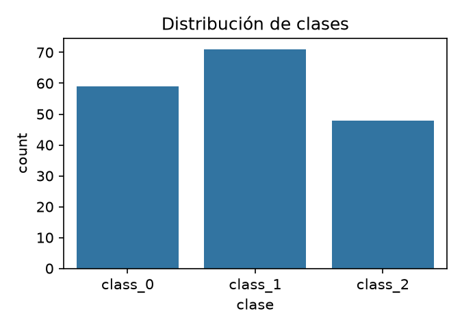
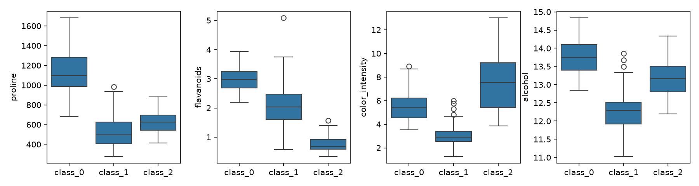
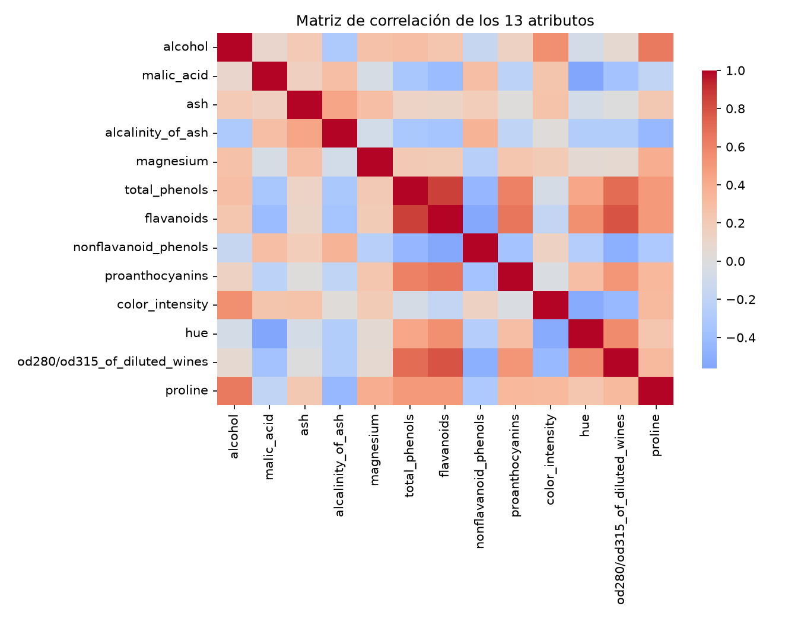
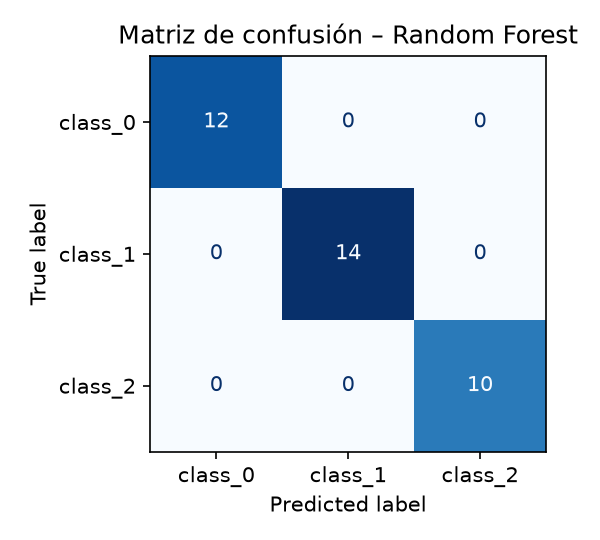
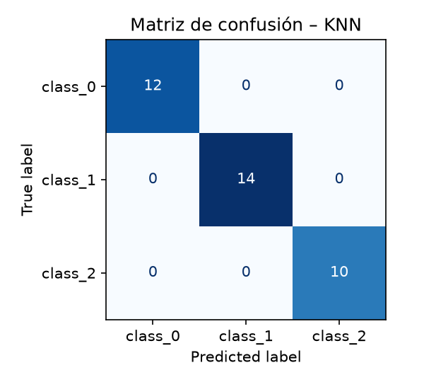
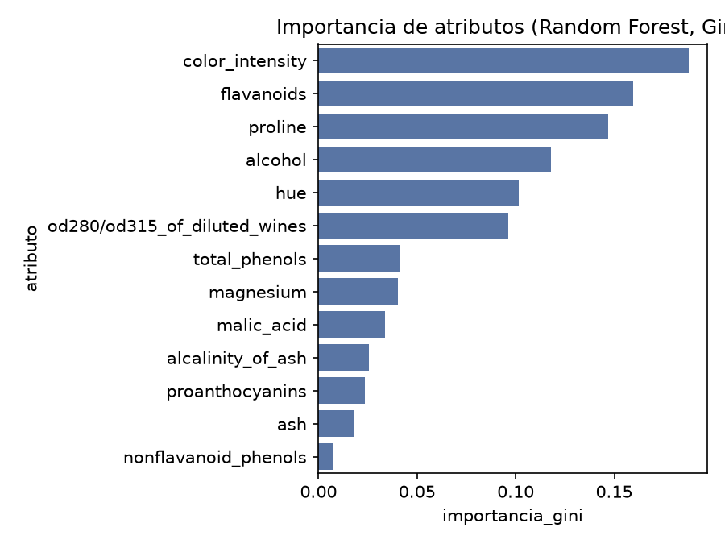
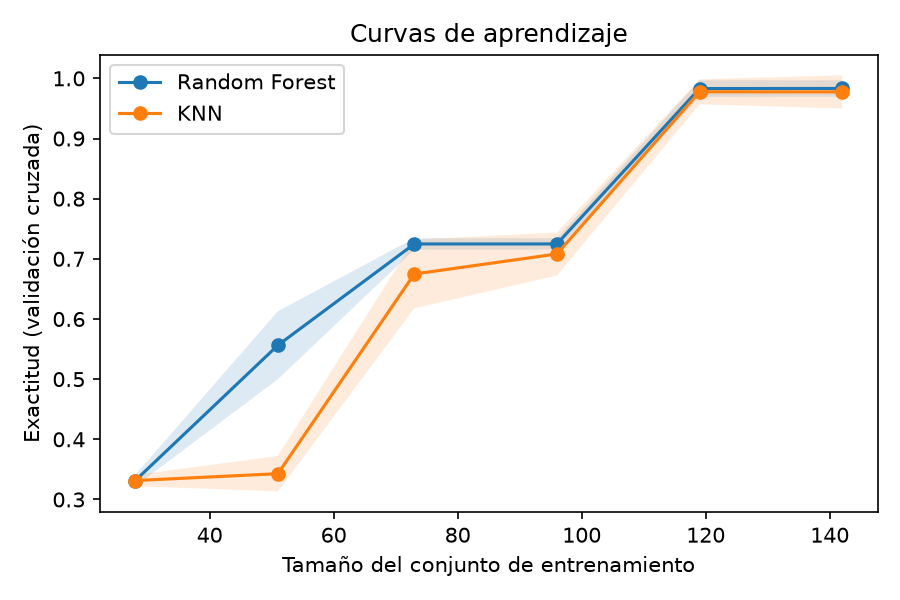

# Clasificación de vinos por composición química: comparación entre Random Forest y KNN

**Autor:** [COMPLETAR: nombre y apellidos]
**Asignatura:** Introducción a la Inteligencia Artificial · Ingeniería Informática · Universidad de Pinar del Río
**Curso:** 2026–2027

---

## 1. Introducción

La evaluación de la calidad y el origen de un vino mediante cata experta es subjetiva, difícil de escalar y poco consistente entre catadores. La industria necesita herramientas de control de calidad, detección de fraude y apoyo al enólogo que sean objetivas y reproducibles.

**Papel de la IA.** Se aborda un problema de **clasificación supervisada**: dada la composición química de una muestra de vino (13 atributos medidos en laboratorio), predecir a cuál de tres cultivares pertenece. No se pretende sustituir al enólogo, sino disponer de un clasificador objetivo y compararlo con alternativas.

**Pregunta de investigación.** ¿Cuál de los algoritmos, Random Forest o KNN, con ajuste riguroso de hiperparámetros, clasifica mejor las muestras, y la diferencia es estadísticamente significativa?

[COMPLETAR: 1–2 párrafos de contexto propio, por ejemplo la relevancia de la vitivinicultura o del control químico en Cuba/Pinar del Río.]

## 2. Desarrollo

### 2.1. Modelación del problema

- **Entrada:** vector x ∈ ℝ¹³ con: alcohol, ácido málico, ceniza, alcalinidad de la ceniza, magnesio, fenoles totales, flavanoides, fenoles no flavanoides, proantocianidinas, intensidad de color, matiz, OD280/OD315 de vinos diluidos y prolina.
- **Salida:** y ∈ {clase_0, clase_1, clase_2}.
- **Objetivo formal:** aprender f: ℝ¹³ → {0,1,2} que minimice el error de clasificación en datos no vistos.
- **Métricas:** exactitud, F1 macro, matriz de confusión; además, tiempo de ajuste y de predicción.

### 2.2. Recolección de datos

Se usa el *Wine dataset* (UCI Machine Learning Repository), distribuido con scikit-learn (`load_wine`). Resultados del análisis exploratorio (`resultados/eda_*.csv`):

| Característica | Valor |
|---|---|
| Muestras | 178 |
| Atributos | 13 (todos numéricos) |
| Clases | 3 (59 / 71 / 48 muestras) |
| Valores faltantes | 0 |

**Limitaciones:** tamaño pequeño; las 3 clases proceden de una sola región, por lo que los resultados pueden no generalizar a otros orígenes; los atributos tienen escalas muy distintas (prolina ≈ 10²–10³ frente a ceniza ≈ 2), lo que obliga a estandarizar para KNN.

[COMPLETAR: comentar qué atributos separan mejor las clases y qué pares están muy correlacionados (p. ej. flavanoides con fenoles totales).]

### 2.3. Revisión bibliográfica

[COMPLETAR con tus propias palabras y con citas. Fuentes sugeridas:]

- Russell, S. y Norvig, P. *Artificial Intelligence: A Modern Approach* (4.ª ed.): capítulo de aprendizaje supervisado (KNN, árboles de decisión y *ensembles*).
- Breiman, L. (2001). *Random Forests*. Machine Learning, 45(1).
- Cover, T. y Hart, P. (1967). *Nearest neighbor pattern classification*.
- Nadeau, C. y Bengio, Y. (2003). *Inference for the generalization error*. Machine Learning, 52.
- Documentación de scikit-learn: `RandomForestClassifier`, `KNeighborsClassifier`, `GridSearchCV`.

Puntos a cubrir: (a) cómo funciona KNN y por qué es sensible a la escala; (b) cómo funciona Random Forest (bagging + selección aleatoria de atributos + voto mayoritario); (c) qué hiperparámetros controlan el sobreajuste en cada uno.

### 2.4. Proyecto de programación

Estructura modular en Python 3 con scikit-learn (ver `README.md`):

| Módulo | Responsabilidad |
|---|---|
| `src/config.py` | Parámetros globales y rejillas |
| `src/datos.py` | Carga, partición estratificada y EDA |
| `src/modelos.py` | Pipelines `StandardScaler` + clasificador |
| `src/experimento.py` | Ajuste, evaluación, significancia, importancias |
| `run_experiment.py` | Orquestación de punta a punta |
| `tests/` | Pruebas de forma de datos, estratificación y entrenamiento |

Decisiones de diseño: semilla fija (42) para reproducibilidad; estandarización dentro del `Pipeline` para evitar fuga de información; el conjunto de prueba solo se usa una vez, al final.

[COMPLETAR: diagrama de flujo del experimento (por ejemplo con Mermaid) y comentarios de ingeniería de software.]

### 2.5. Descripción del experimento

**Protocolo.**

1. Partición 80/20 estratificada: 142 muestras de entrenamiento y 36 de prueba.
2. Ajuste con `GridSearchCV` (5-fold estratificado, F1 macro) solo sobre entrenamiento.
3. Evaluación del mejor modelo de cada familia sobre el conjunto de prueba.
4. Comparación estadística con 10×(5-fold) sobre las 178 muestras.

**Ajuste de hiperparámetros** (`resultados/tuning.json`):

| Modelo | Combinaciones | Mejores hiperparámetros | F1 macro (CV) | Tiempo de ajuste |
|---|---|---|---|---|
| Random Forest | 64 | 100 árboles, profundidad sin límite, `max_features="sqrt"`, `min_samples_split=2` | 0,979 | ≈ 52 s |
| KNN | 168 | k = 7, distancia Manhattan, pesos uniformes, algoritmo `auto` | 0,979 | ≈ 5 s |

**Resultados en el conjunto de prueba** (`resultados/comparacion.csv`):

| Modelo | Exactitud | F1 macro | Tiempo de predicción (36 muestras) |
|---|---|---|---|
| Random Forest | 1,000 | 1,000 | ≈ 5 ms |
| KNN | 1,000 | 1,000 | ≈ 2 ms |

**Comparación estadística** (`resultados/significancia.json`, 50 evaluaciones por modelo):

| Modelo | Exactitud media (CV) | Desv. típica |
|---|---|---|
| Random Forest | 0,978 | 0,025 |
| KNN | 0,974 | 0,026 |

- Diferencia media: 0,0045 a favor de Random Forest.
- t-test pareado corregido (Nadeau–Bengio): t = 0,31, p = 0,755.
- Wilcoxon: p = 0,127.

**Importancia de atributos** (`resultados/importancia_rasgos.csv`): los más relevantes según Random Forest son intensidad de color, flavanoides y prolina, seguidos de alcohol, matiz y OD280/OD315.

[COMPLETAR: interpretar las curvas de aprendizaje (¿convergen los modelos con pocos datos?) y relacionar los atributos importantes con la química del vino.]

**Advertencia sobre la validez de los resultados.** Con solo 36 muestras de prueba, ambos modelos alcanzan 100 % de exactitud, por lo que esa partición no distingue entre ellos: un solo error cambiaría la exactitud en 2,8 puntos. Por eso se añadió la validación cruzada repetida, que sí da un intervalo más fiable (≈ 97–98 %) y muestra que la diferencia no es significativa.

## 3. Conclusiones y recomendaciones

**Conclusiones** (verifícalas con tus propias ejecuciones antes de entregar):

1. Ambos algoritmos clasifican el Wine dataset con una exactitud cercana al 98 % tras el ajuste de hiperparámetros.
2. **No hay evidencia de que un método sea mejor** (p > 0,05 en ambas pruebas). Con diferencia de rendimiento nula, la elección debe basarse en otros criterios.
3. KNN es unas 10 veces más rápido de ajustar y ligeramente más rápido de predecir con este tamaño de datos; Random Forest aporta interpretabilidad mediante la importancia de atributos.
4. La estandarización es imprescindible para KNN, dada la diferencia de escalas entre atributos.

**Recomendaciones y trabajo futuro:**

- Validar en otro dataset de vinos (por ejemplo, el de calidad de vino tinto/blanco de UCI) para comprobar la generalización.
- Probar calibración de probabilidades, SVM y *gradient boosting*.
- Con datos reales de bodegas locales, repetir el experimento y revisar si persiste el empate.

## Referencias

[COMPLETAR: lista en el formato exigido por la asignatura.]
